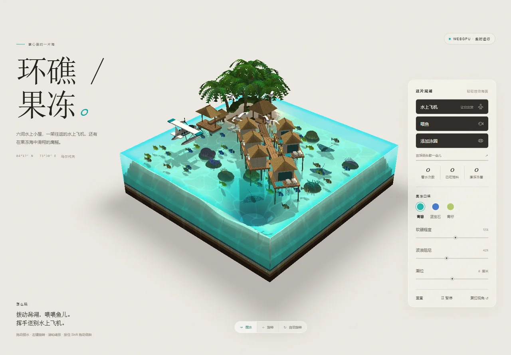

# 环礁果冻 · Atoll Jelly

一块可以拨动的碧蓝潟湖：棕榈小岛、水上小屋、起降的水上飞机、白色海鸥，以及在水下游动的鱼群和鹰鳐。

**[打开网站](https://iland.ak1na.com/)** · [Ak1na 主站](https://ak1na.com/)



## 怎么玩

- 拖动水面制造波纹；右键拖动旋转视角，滚轮缩放。
- 点击「水上飞机」让它出发或提前返航，「喂鱼」投放饲料，「添加泳圈」会在可用水域随机投放，避开建筑、飞机和已有泳圈；添加后可以抓取、拖动和抛出；漂浮时跟随波浪与水流、柔和碰撞并沿建筑边缘滑开；从上方抛下仍可落在甲板或沙滩上。
- 调整果冻口味、软硬程度、波浪阻尼和潮位，或开启自动旋转观看不同角度。
- 手机支持触控拨水、双指旋转与缩放，底部面板可以收起。
- 暂停会停止模拟；自动旋转仍可用于查看静止场景。

## 本地运行

安装 Node.js 后，在项目目录运行：

```sh
node preview.mjs
```

打开终端显示的 `http://127.0.0.1:4179/`。运行环境需要支持 WebGPU 的浏览器；WebGPU 要求 HTTPS 或 localhost 安全上下文，不支持时页面会显示提示卡。

## 实现

`index.html` 自包含页面样式、原生 WebGPU 渲染器、WGSL 着色器和 JavaScript 模拟，无需构建、依赖安装、外部模型、纹理、字体或运行时网络请求。

- 168 × 168 浅水网格，以 120 Hz 固定步长更新水面。
- 程序化小岛、珊瑚、棕榈、水屋、泳圈、飞机、鱼群、鳐鱼和海鸥。
- 飞机自动完成等候、掉头、滑行、起飞、巡航、进近、着水和返泊。
- 鳐鱼使用前瞻检查、限速转向和缓慢后退避障；飞机的浅层滑跑通道会预留。
- 海鸥以不同节奏交替拍翼和滑翔；鱼尾、鳐鱼翼面和螺旋桨由顶点着色器驱动。
- `window.__aj` 暴露模拟状态和控制接口，便于检查与调试。

这是微缩景观中的近似水体与生物运动模拟。

## 项目来源

项目来源：Atoll Jelly 互动式 WebGPU 泻湖立体场景。

## 文件

- `index.html`：完整互动场景，也是静态托管入口。
- `assets/preview.webp`：真实页面截图，仅用于项目预览。
- `preview.mjs`：零依赖的本地静态预览服务。

部署时可直接托管 `index.html`；项目演示地址为 `https://iland.ak1na.com/`。公开仓库未附开源许可证，未另行授予再分发或修改许可。
